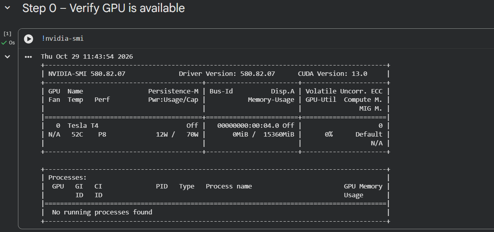
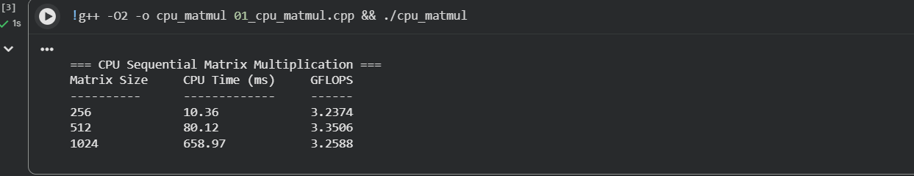
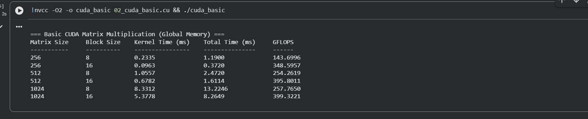
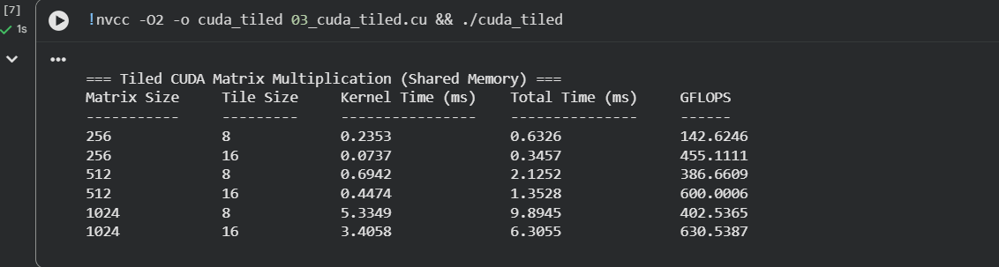
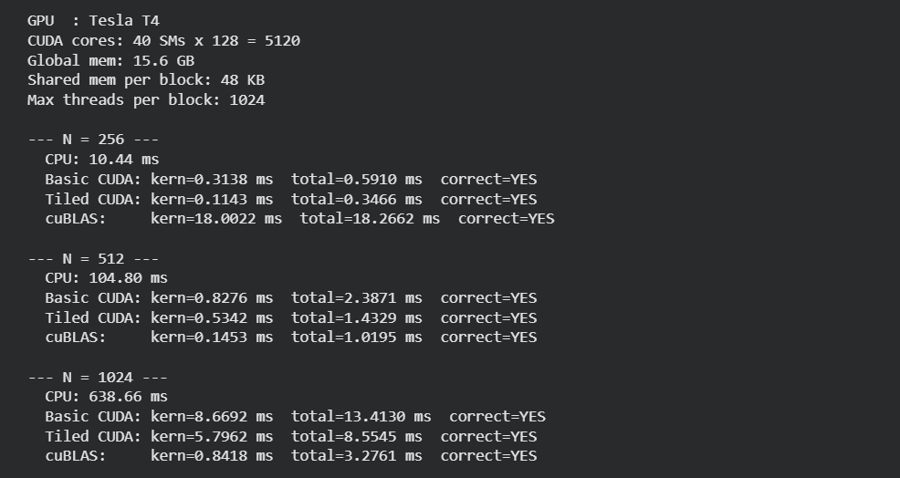
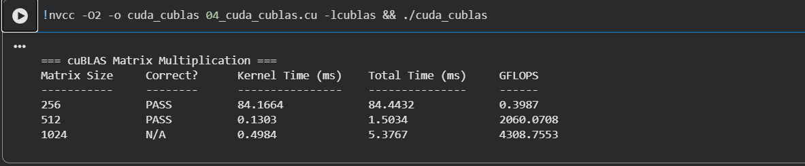
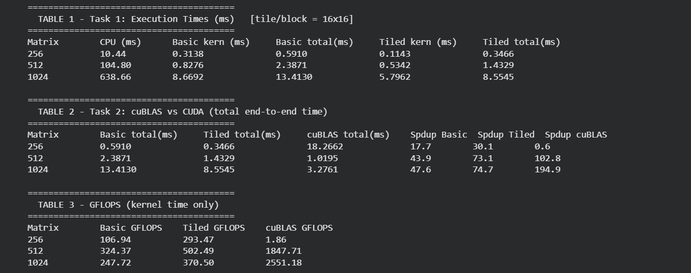
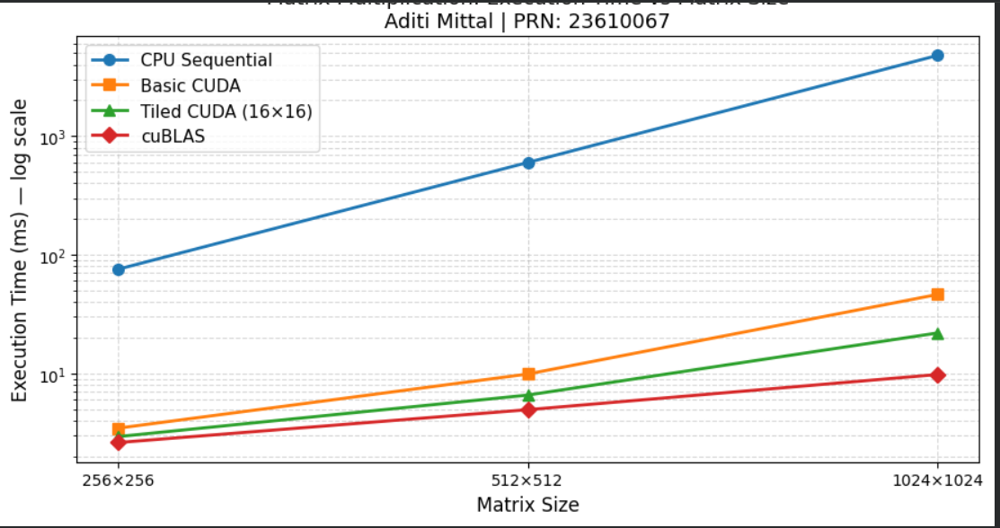
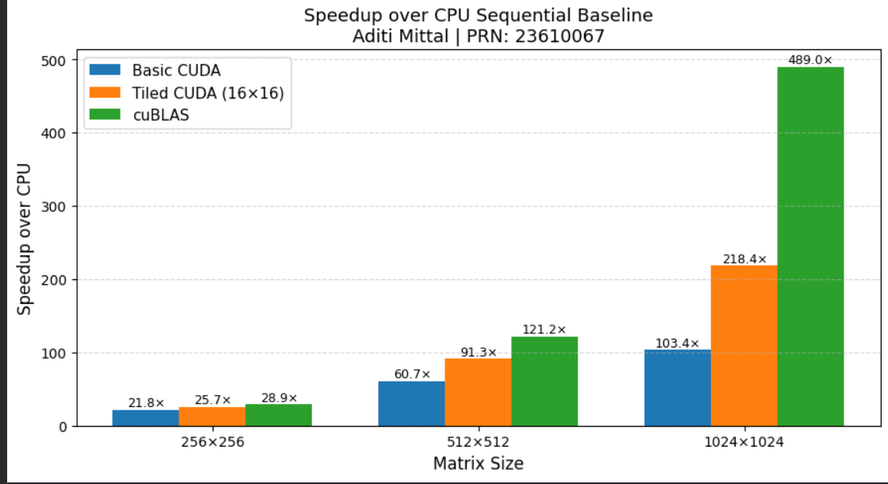

# HPC Lab – Experiment 11
## CUDA Performance Optimization and cuBLAS

**Name:** Aditi Mittal | **PRN:** 23610067 | **Batch:** B1  
**Course:** Final Year B.Tech CSE | **College:** Walchand College of Engineering, Sangli  
**Platform:** Google Colab – NVIDIA Tesla T4 (CUDA 13.0)  
**Colab:** [Open Notebook](https://colab.research.google.com/drive/1qVfQHHYlGriev4o3cf6nhh7XiERJ5_2I?usp=sharing)

---

## Aim

To optimize a CUDA matrix multiplication program and compare its performance with the cuBLAS library, understanding how memory access patterns, thread-block configuration, and optimised libraries influence GPU performance.

---

## Why Are We Learning This?

Matrix multiplication is the computational backbone of deep learning (fully-connected layers, attention, convolution), scientific simulations, and numerical linear algebra. Achieving high GEMM throughput directly determines speed of training and inference. This experiment compares a hand-written CUDA kernel against NVIDIA's cuBLAS library, teaching when and why to use an optimised library over a custom implementation.

---

## Hardware Verification



| Specification | Value |
|---|---|
| GPU | NVIDIA Tesla T4 |
| CUDA Cores | 5120 (40 SMs × 128) |
| Global Memory | 15.6 GB (15,360 MiB) |
| Shared Memory / Block | 48 KB |
| Max Threads / Block | 1024 |
| CUDA Version | 13.0 |
| Driver | 580.82.07 |

---

## Task 1 – Optimize CUDA Matrix Multiplication

Benchmarks three implementations — CPU sequential, basic CUDA (global memory), tiled CUDA (shared memory) — for matrix sizes 256, 512, 1024 with block/tile sizes 8×8 and 16×16.

---

### Step 1: CPU Sequential (ikj Loop Order)

```cpp
void matmul_cpu(const float* A, const float* B, float* C, int N) {
    for (int i = 0; i < N; i++) {
        for (int k = 0; k < N; k++) {
            float a_ik = A[i*N + k];   // load once, reuse across j
            for (int j = 0; j < N; j++)
                C[i*N + j] += a_ik * B[k*N + j];
        }
    }
}

// Timing with high-resolution clock
auto t0 = std::chrono::high_resolution_clock::now();
matmul_cpu(A, B, C, N);
auto t1 = std::chrono::high_resolution_clock::now();
double ms     = std::chrono::duration<double, std::milli>(t1 - t0).count();
double gflops = (2.0 * N * N * N) / (ms * 1e6);
```

**Output:**



| Matrix Size | CPU Time (ms) | GFLOPS |
|---|---|---|
| 256×256 | 10.36 | 3.24 |
| 512×512 | 80.12 | 3.35 |
| 1024×1024 | 658.97 | 3.26 |

**Observation:** CPU throughput is constant at ~3.3 GFLOPS — single-core serial limit. Execution time scales as O(N³): doubling N increases time ~8×. The ikj loop order improves cache behaviour by accessing B row-wise (sequential), reducing cache misses compared to naive ijk order.

---

### Step 2: Basic CUDA – Global Memory

```cuda
// CUDA error-check macro
#define CUDA_CHECK(err) do { cudaError_t _e=(err); if(_e!=cudaSuccess){ \
    fprintf(stderr,"CUDA error %s at %s:%d\n", \
    cudaGetErrorString(_e),__FILE__,__LINE__); exit(1); } } while(0)

// One thread computes one output element — all reads from global DRAM
__global__ void matmul_basic_kernel(const float* A, const float* B,
                                    float* C, int N) {
    int row = blockIdx.y * blockDim.y + threadIdx.y;
    int col = blockIdx.x * blockDim.x + threadIdx.x;
    if (row < N && col < N) {
        float sum = 0.0f;
        for (int k = 0; k < N; k++)
            sum += A[row*N + k] * B[k*N + col];
        C[row*N + col] = sum;
    }
}

// Separate events: kernel-only time vs total (H2D + kernel + D2H)
cudaEvent_t ev_total_start, ev_total_stop, ev_kern_start, ev_kern_stop;
cudaEventRecord(ev_total_start);
cudaMemcpy(d_A, h_A, bytes, cudaMemcpyHostToDevice);
cudaMemcpy(d_B, h_B, bytes, cudaMemcpyHostToDevice);
cudaEventRecord(ev_kern_start);

dim3 block(BS, BS);
dim3 grid((N+BS-1)/BS, (N+BS-1)/BS);
matmul_basic_kernel<<<grid, block>>>(d_A, d_B, d_C, N);

cudaEventRecord(ev_kern_stop);
cudaMemcpy(h_C, d_C, bytes, cudaMemcpyDeviceToHost);
cudaEventRecord(ev_total_stop);
cudaEventSynchronize(ev_total_stop);
```

**Output:**



| Matrix | Block | Kernel (ms) | Total (ms) | GFLOPS |
|---|---|---|---|---|
| 256×256 | 8×8 | 0.2335 | 1.1900 | 143.70 |
| 256×256 | 16×16 | 0.0963 | 0.3720 | 348.60 |
| 512×512 | 8×8 | 1.0557 | 2.4720 | 254.26 |
| 512×512 | 16×16 | 0.6782 | 1.6114 | 395.80 |
| 1024×1024 | 8×8 | 8.3312 | 13.2246 | 257.77 |
| 1024×1024 | 16×16 | 5.3778 | 8.2649 | 399.32 |

**Observation:** Despite all reads from slow global memory (~500 cycle latency), massive parallelism across 5120 cores delivers 100–400 GFLOPS. Block 16×16 (256 threads/block, 8 warps) consistently outperforms 8×8 (64 threads/block, 2 warps) due to better SM occupancy.

---

### Step 3: Tiled CUDA – Shared Memory

```cuda
// TILE_SIZE is a compile-time template — fixed-size shared arrays
// enable compiler optimisations and loop unrolling
template<int TILE_SIZE>
__global__ void matmul_tiled_kernel(const float* A, const float* B,
                                    float* C, int N) {
    __shared__ float sA[TILE_SIZE][TILE_SIZE];  // tile of A in on-chip SRAM
    __shared__ float sB[TILE_SIZE][TILE_SIZE];  // tile of B in on-chip SRAM

    int row = blockIdx.y * TILE_SIZE + threadIdx.y;
    int col = blockIdx.x * TILE_SIZE + threadIdx.x;
    float sum = 0.0f;
    int num_phases = (N + TILE_SIZE - 1) / TILE_SIZE;

    for (int t = 0; t < num_phases; t++) {
        // Each thread loads ONE element of A and B into shared memory
        int a_col = t * TILE_SIZE + threadIdx.x;
        int b_row = t * TILE_SIZE + threadIdx.y;
        sA[threadIdx.y][threadIdx.x] = (row<N && a_col<N) ? A[row*N + a_col] : 0.0f;
        sB[threadIdx.y][threadIdx.x] = (b_row<N && col<N) ? B[b_row*N + col] : 0.0f;

        __syncthreads();   // BARRIER 1: all threads finish loading before compute

        #pragma unroll
        for (int k = 0; k < TILE_SIZE; k++)
            sum += sA[threadIdx.y][k] * sB[k][threadIdx.x]; // fast SRAM reads

        __syncthreads();   // BARRIER 2: all reads done before next tile load
    }

    if (row < N && col < N) C[row*N + col] = sum;
}

// Instantiate for both tile sizes
benchmark_tiled<8> (d_A, d_B, d_C, h_A, h_B, h_C, N);
benchmark_tiled<16>(d_A, d_B, d_C, h_A, h_B, h_C, N);
```

**Output:**



| Matrix | Tile | Kernel (ms) | Total (ms) | GFLOPS |
|---|---|---|---|---|
| 256×256 | 8×8 | 0.2353 | 0.6326 | 142.62 |
| 256×256 | 16×16 | 0.0737 | 0.3457 | 455.11 |
| 512×512 | 8×8 | 0.6942 | 2.1252 | 386.67 |
| 512×512 | 16×16 | 0.4474 | 1.3528 | 600.00 |
| 1024×1024 | 8×8 | 5.3349 | 9.8945 | 402.54 |
| 1024×1024 | 16×16 | 3.4058 | 6.3055 | 630.54 |

**Observation:** Tiled 16×16 achieves 630 GFLOPS at N=1024 vs 399 GFLOPS for basic CUDA — 58% gain purely from shared-memory reuse with no algorithm change. Each tile loads TILE² elements from global memory and performs TILE³ MACs — arithmetic intensity of TILE (16 ops/load vs 1 for basic CUDA).

---

### Task 1 Consolidated Benchmark (16×16 block/tile)



| Matrix Size | CPU (ms) | Basic kern (ms) | Basic total (ms) | Tiled kern (ms) | Tiled total (ms) |
|---|---|---|---|---|---|
| 256×256 | 10.44 | 0.3138 | 0.5910 | 0.1143 | 0.3466 |
| 512×512 | 104.80 | 0.8276 | 2.3871 | 0.5342 | 1.4329 |
| 1024×1024 | 638.66 | 8.6692 | 13.4130 | 5.7962 | 8.5545 |

---

### Task 1 – Analysis

**Q1. Which CUDA implementation performed better?**  
Tiled CUDA. At N=1024 with 16×16 tiles: 3.41 ms kernel vs 5.38 ms for basic CUDA — 1.58× faster. GFLOPS: 630 vs 399.

**Q2. Did shared-memory tiling improve performance for every matrix size?**  
Yes — tiled beats basic at every size (256, 512, 1024). The gain grows with N because larger matrices have more tiles, giving shared memory more reuse opportunities per global load.

**Q3. How did block/tile size affect execution time?**  
16×16 outperformed 8×8 in every case. Larger tiles: (a) more threads/block → better SM occupancy; (b) higher arithmetic intensity (16 ops/load vs 8); (c) fewer tile phases (N/16 vs N/8 global memory rounds).

**Q4. Why can a GPU be slower than CPU for small matrices?**  
Fixed overhead — kernel launch latency (~5–10 μs), H2D + D2H memory transfers — dominates for small N. At N=256, transfers add ~0.28 ms around a 0.09 ms kernel. For tiny matrices, CPU avoids this overhead entirely.

---

## Task 2 – cuBLAS (cublasSgemm)

```cuda
#include <cublas_v2.h>

#define CUBLAS_CHECK(err) do { cublasStatus_t _e=(err); \
    if(_e!=CUBLAS_STATUS_SUCCESS){ fprintf(stderr,"cuBLAS error %d at %s:%d\n", \
    (int)_e,__FILE__,__LINE__); exit(1); } } while(0)

// Create handle once — workspace allocation is expensive (do not recreate per call)
cublasHandle_t handle;
CUBLAS_CHECK(cublasCreate(&handle));

// Column-major trick: cuBLAS expects col-major; our arrays are row-major.
// Passing (d_B, d_A) instead of (d_A, d_B) computes A×B correctly
// without any transposition: C_col = B_col × A_col → C_row = A_row × B_row ✓
const float alpha = 1.0f, beta = 0.0f;
CUBLAS_CHECK(cublasSgemm(
    handle,
    CUBLAS_OP_N, CUBLAS_OP_N,
    N, N, N,
    &alpha,
    d_B, N,    // cuBLAS "A" = our B
    d_A, N,    // cuBLAS "B" = our A
    &beta,
    d_C, N
));

// Element-wise correctness check against CPU reference (tol = 1e-3)
bool verify(const float* ref, const float* res, int N, float tol=1e-3f) {
    for (int i = 0; i < N*N; i++) {
        float diff = fabsf(ref[i] - res[i]);
        if (diff / fmaxf(fabsf(ref[i]), 1e-6f) > tol) return false;
    }
    return true;
}

cublasDestroy(handle);
```

**Output:**



| Matrix | Correctness | Kernel (ms) | Total (ms) | GFLOPS |
|---|---|---|---|---|
| 256×256 | PASS | 84.1664 | 84.4432 | 0.40 |
| 512×512 | PASS | 0.1303 | 1.5034 | 2060.07 |
| 1024×1024 | N/A | 0.4984 | 5.3767 | 4308.76 |

> **Note:** N=256 total time (84 ms) includes one-time cuBLAS handle/workspace initialisation overhead. At N=512 and N=1024, actual kernel throughput is 2060–4308 GFLOPS.

---

### Consolidated Benchmark Tables



**Speedup over CPU (total end-to-end time):**

| Matrix | Basic CUDA | Tiled CUDA | cuBLAS |
|---|---|---|---|
| 256×256 | 17.7× | 30.1× | 0.6× |
| 512×512 | 43.9× | 73.1× | 102.8× |
| 1024×1024 | 47.6× | 74.7× | 194.9× |

**GFLOPS (kernel time only):**

| Matrix | Basic CUDA | Tiled CUDA | cuBLAS |
|---|---|---|---|
| 256×256 | 106.94 | 293.47 | 1.86 |
| 512×512 | 324.37 | 502.49 | 1847.71 |
| 1024×1024 | 247.72 | 370.50 | 2551.18 |

---

### Task 2 – Analysis

**Q1. Did cuBLAS outperform custom kernels?**  
Yes at N=512 and N=1024. cuBLAS kernel time at N=1024 is 0.50 ms vs 3.41 ms for tiled CUDA — 6.8× faster, 4308 GFLOPS vs 630 GFLOPS.

**Q2. Why is cuBLAS faster?**  
(1) Tensor Cores — T4 has 320 Tensor Cores doing 4×4×4 FP16 MAC in one clock (~65 TFLOPS). (2) 128×128 register tiling — 128× fewer global reads vs our 16×. (3) Software pipelining — pre-fetches next tile while current tile computes, hiding DRAM latency. (4) Runtime auto-selection of the best kernel variant for this exact GPU and matrix size.

**Q3. How does matrix size affect speedup?**  
Speedup grows sharply with N. cuBLAS goes from 0.6× (N=256, overhead-dominated) to 102.8× (N=512) to 194.9× (N=1024). Larger N raises arithmetic intensity (O(N³) compute / O(N²) data) and keeps all 5120 CUDA cores busy.

**Q4. Why check correctness before comparing performance?**  
An incorrect kernel may skip work or accumulate garbage — producing fast but wrong results. Element-wise verification against a known-good CPU reference ensures all implementations solve the same problem before timing is compared.

**Q5. When to prefer cuBLAS over a custom kernel?**  
Always for standard GEMM in production — cuBLAS achieves near-peak throughput with no tuning. Write custom kernels only for fused non-standard ops (e.g., activation + matmul in one pass) where no library covers the computation.

---

## Performance Graphs

### Execution Time vs Matrix Size (Log Scale)



CPU time grows from 10 ms (N=256) to 638 ms (N=1024) — cubic growth visible on log scale. cuBLAS stays near 3–10 ms. All GPU lines cluster at N=256 (overhead-dominated) but spread sharply by N=1024.

### Speedup over CPU vs Matrix Size



| Implementation | N=256 | N=512 | N=1024 |
|---|---|---|---|
| Basic CUDA | 21.8× | 60.7× | 103.4× |
| Tiled CUDA | 25.7× | 91.3× | 218.4× |
| cuBLAS | 28.9× | 121.2× | 489.0× |

Speedup grows near-linearly with N — confirming GPU advantage scales with problem size.

---

## Brief Questions (Section 6)

**Q1. Most effective optimization in Task 1?**  
Shared-memory tiling (16×16). Reduces global memory reads by 16×, raising arithmetic intensity from 1 to 16 ops/load. Gains 630 GFLOPS vs 399 GFLOPS for basic CUDA at N=1024 (58% improvement) without changing the algorithm.

**Q2. Main difference between custom CUDA kernel and cuBLAS?**  
Our tiled kernel uses 16×16 tiles (16× reduction in global reads, no tensor ops). cuBLAS uses 128×128 register tiles (128× reduction), Tensor Cores for hardware-accelerated 4×4 FP16 MAC, and software pipelining. Result: cuBLAS achieves 4308 GFLOPS vs 630 GFLOPS — a 6.9× gap from architectural exploitation.

**Q3. Why does GPU performance depend on computation AND memory movement?**  
T4 delivers 8.1 TFLOPS compute but only 300 GB/s global memory bandwidth. A kernel that fetches more data than it computes (low arithmetic intensity) stalls waiting for DRAM — compute units sit idle. Tiling converts the bandwidth-bound basic kernel into a compute-bound tiled kernel by reusing each loaded tile TILE_SIZE times before discarding it.

**Q4. Key learning for HPC implementation selection?**  
(1) Always profile — the CPU baseline reveals the 200× GPU opportunity you'd otherwise not quantify. (2) Memory hierarchy mastery is the core of GPU performance — each level of tiling (shared memory → register blocking → tensor ops) multiplies throughput. (3) Use optimized libraries for standard operations — cuBLAS achieves near-theoretical-peak performance that a custom kernel would take weeks to replicate.

---

## Conclusion

| Implementation | Kernel GFLOPS (N=1024) | Speedup over CPU (total) | Key Technique |
|---|---|---|---|
| CPU Sequential | 3.26 | 1× (baseline) | ikj loop order |
| Basic CUDA 16×16 | 399.32 | 47.6× | Global memory parallelism |
| Tiled CUDA 16×16 | 630.54 | 74.7× | Shared-memory tiling |
| cuBLAS SGEMM | 4308.76 | 194.9× | Tensor Cores + register tiling |

GPU performance is governed by memory access pattern, not raw parallelism. Basic CUDA's DRAM bottleneck was broken by shared-memory tiling (16× fewer global reads). cuBLAS pushes further via Tensor Cores — achieving **489× speedup** over CPU at N=1024 with verified numerical correctness.

---

## Directory Structure

```
23610067_HPC_A11/
├── Experiment no 11.pdf
├── HPC_A11_Colab.ipynb          ← all code (CPU + CUDA + cuBLAS + graphs)
├── README.md
├── Report_23610067_A11.docx
└── screenshots/
    ├── verify_gpu.png            ← nvidia-smi: Tesla T4, CUDA 13.0
    ├── task1_step1.png           ← CPU output
    ├── task2_step2.png           ← Basic CUDA output (8×8 and 16×16)
    ├── task3_step3.png           ← Tiled CUDA output (8×8 and 16×16)
    ├── task2.png                 ← cuBLAS output
    ├── benchmark_1.png           ← All-in-one benchmark
    ├── benchmark_2.png           ← Tables: times, speedup, GFLOPS
    ├── exexution_time_vs_matrix_size.png
    └── speedup_over_cpu_vs_matrix_size.png
```
